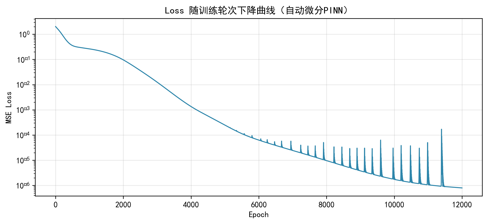
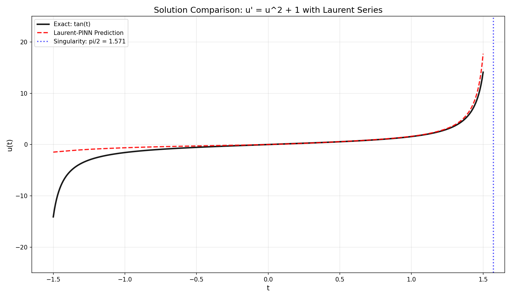

<div align="center">

  # 🔬 Research & Project Portfolio

  <p align="center">
    <em>Physics-Informed Neural Networks · Mathematical Modeling · Computational Intelligence</em>
  </p>

  <p align="center">
    <a href="https://github.com/Zhouyi-Wang"></a>
    <a href="mailto:"></a>
    
    
    
  </p>

  <p align="center">
    
    
  </p>

</div>

---

## 📋 About This Repository

Welcome to my research portfolio! This repository showcases my work in **computational mathematics**, **machine learning**, and **mathematical modeling**. It consolidates projects from academic research, competitions, and coursework — demonstrating both theoretical depth and practical implementation skills.

> 🎯 **Focus Areas**: Physics-Informed Neural Networks (PINNs) · Bayesian Deep Learning · Mathematical Optimization · Scientific Computing

---

## 🏗️ Repository Structure

```
MyJob/
├── 📂 pinn-research/              # Physics-Informed Neural Networks Research
│   ├── 📂 bayesian-pinn/          # Bayesian PINN with uncertainty quantification
│   ├── 📂 laurent-pinn/           # Laurent series enhanced PINN for singularities
│   ├── 📂 pure-pinn/              # Standard PINN with ResNet architecture
│   ├── 📂 uncertainty-analysis/   # Uncertainty band exploration & visualization
│   ├── 📂 experiments/            # Experimental scripts & test cases
│   ├── 📂 utils/                  # Utility functions & visualization tools
│   └── 📂 results/                # Training results & comparison plots
│
├── 📂 mathematical-modeling/      # Mathematical Modeling Competitions
│   ├── 📂 apmcm-2026-opc-location/ # APMCM 2026 Problem C — Site Selection
│   └── 📂 templates/              # LaTeX templates for MCM/ICM papers
│
├── 📂 course-projects/            # Academic Course Projects
│   └── 📂 smartwear-outfit-stylist/ # SmartWear: AI-Powered Outfit Stylist
│
├── 📂 assets/                     # Images & static assets
├── 📂 docs/                       # Additional documentation
├── 📄 requirements.txt            # Python dependencies
└── 📄 README.md                   # 👈 You are here
```

---

## 🌟 Featured Projects

### 1. 🔮 Bayesian Physics-Informed Neural Networks (BPINN)

**Bayesian PINN with Uncertainty Quantification** — A variational inference approach to PINNs that provides principled uncertainty estimates alongside PDE solutions.

| Feature | Description |
|---------|-------------|
| **Method** | Variational Bayes with reparameterization trick |
| **PDE** | ODE parameter inference (e.g., decay equations) |
| **Framework** | PyTorch + custom variational layers |
| **Key Result** | Stable λ estimation with calibrated uncertainty bands |

📂 [Explore BPINN →](./pinn-research/bayesian-pinn/)

---

### 2. 📐 Laurent Series-Enhanced PINN

**Handling Singularities in PINNs** — A novel hybrid architecture combining neural networks with Laurent series expansions to solve PDEs near singular points.

| Feature | Description |
|---------|-------------|
| **Innovation** | NN + Laurent series hybrid architecture |
| **Problem** | PDEs with singular solutions (e.g., blow-up behavior) |
| **Mechanism** | Adaptive gating between NN and analytic terms |
| **Advantage** | Superior accuracy near singularities |

📂 [Explore Laurent PINN →](./pinn-research/laurent-pinn/)

---

### 3. 🏆 APMCM 2026 — OPC Community Site Selection

**Winner-level mathematical modeling solution** for the Asia-Pacific Mathematical Contest in Modeling (APMCM) 2026 Problem C.

| Aspect | Method Used |
|--------|-------------|
| **Site Selection** | AHP + Entropy Weight + TOPSIS |
| **Demand Forecasting** | Logistic Growth Model |
| **Resource Allocation** | M/M/c Queueing Theory |
| **Economic Analysis** | Static & Dynamic ROI over 10-year horizon |
| **Sensitivity** | Monte Carlo simulation |

📄 [Read the Paper (PDF)](./mathematical-modeling/apmcm-2026-opc-location/paper.pdf) ·
📂 [View Project →](./mathematical-modeling/apmcm-2026-opc-location/)

---

## 🛠️ Technical Skills

### Programming & Frameworks
<p align="left">
  
  
  
  
  
  
  
</p>

### Research Areas
- **🧠 Deep Learning**: Bayesian Neural Networks, Physics-Informed Neural Networks, Uncertainty Quantification
- **📊 Mathematical Modeling**: Multi-criteria Decision Making, Queueing Theory, Optimization
- **🔬 Scientific Computing**: PDE Numerical Methods, Differential Equations, Stochastic Processes

---

## 🚀 Getting Started

### Prerequisites

```bash
Python 3.8+
PyTorch 2.0+
NumPy, Matplotlib, SciPy
```

### Installation

```bash
# Clone the repository
git clone https://github.com/Zhouyi-Wang/MyJob.git
cd MyJob

# Install dependencies
pip install -r requirements.txt
```

### Running PINN Experiments

```bash
# Bayesian PINN example
cd pinn-research/bayesian-pinn
python bpinn_final.py

# Laurent PINN example
cd ../laurent-pinn
python laurent_pinn.py
```

---

## 📊 Sample Results

<div align="center">

| Loss Convergence | Solution Comparison |
|:----------------:|:-------------------:|
|  |  |

</div>

---

## 📫 Contact

<p align="center">
  <em>Interested in collaboration or have questions about my work?</em>
  <br><br>
  <a href="https://github.com/Zhouyi-Wang">
    
  </a>
  <a href="mailto:your.email@example.com">
    
  </a>
</p>

---

<div align="center">

  **If you find this work interesting, give it a ⭐ star!**

  <sub>Built with ❤️ by Zhouyi Wang</sub>

</div>
